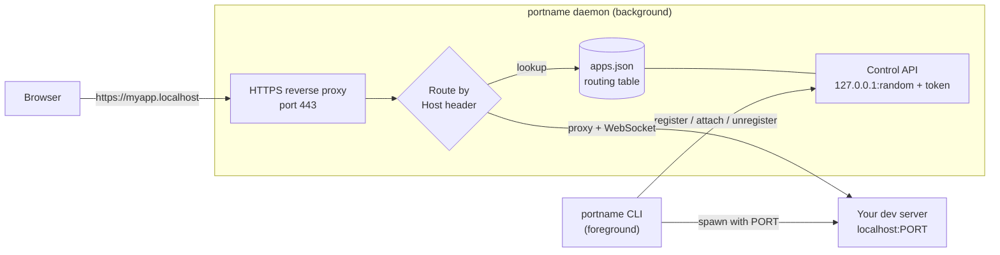

# portname

Local development reverse proxy that replaces constantly-changing `http://localhost:<port>` URLs with stable, memorable `https://<name>.localhost` URLs.

Run `portname myapp npm run dev` and your app is reachable at `https://myapp.localhost` — the port is assigned automatically, HTTPS works, and WebSocket/HMR keeps working. No more "which port was that on again?".

```
  portname  myapp
  ────────────────────────────────────────────────
  URL     https://myapp.localhost
  Local   http://localhost:3000
  PID     48213
  ────────────────────────────────────────────────
```

---

## Table of contents

- [Features](#features)
- [Requirements](#requirements)
- [Installation](#installation)
  - [Global installation](#global-installation)
  - [Project-local installation](#project-local-installation)
- [Quick start](#quick-start)
- [Command reference](#command-reference)
- [How it works](#how-it-works)
  - [Architecture](#architecture)
  - [Request lifecycle](#request-lifecycle)
  - [Port assignment](#port-assignment)
- [Why is the browser showing "Not secure"?](#why-is-the-browser-showing-not-secure)
- [Tools used](#tools-used)
- [Configuration](#configuration)
- [Data and files](#data-and-files)
- [Troubleshooting](#troubleshooting)
- [Development](#development)
- [License](#license)

---

## Features

- **Stable URLs** — `https://<name>.localhost` instead of `localhost:3000`, `localhost:5173`, `localhost:8080`, ...
- **Automatic port assignment** — the proxy picks a free app port and injects it into your dev server.
- **HTTPS by default** — a local certificate authority issues a trusted cert for `localhost`, `*.localhost`, `127.0.0.1`, and `::1`.
- **WebSocket / HMR support** — upgrade requests are proxied, so Vite, Next.js, and webpack hot reload keep working.
- **Background daemon** — one proxy process owns the routing table; start as many apps as you like.
- **IPv4 and IPv6 aware** — routes to whichever loopback address your dev server actually bound to (`127.0.0.1` or `::1`).
- **Zero config** — sensible defaults, everything overridable via environment variables.

## Requirements

- **Node.js >= 18** (uses ES modules, `node --test`, and `closeIdleConnections`).
- No build step. The only runtime dependency is [`node-forge`](https://github.com/digitalbazaar/forge) for certificate generation.

---

## Installation

### Global installation

Installing globally makes the `portname` command available in every project.

#### Option A — link from a local clone (recommended while developing)

```bash
git clone <this-repo> portname
cd portname
npm install
npm link
```

`npm link` creates a global symlink from your npm global `bin` directory to this folder. Any edit you make here takes effect immediately — no reinstall needed.

Verify:

```bash
portname --help
```

Remove it later with:

```bash
npm unlink -g portname
```

#### Option B — install globally from a path

```bash
npm install -g /absolute/path/to/portname
```

or, from inside the project directory:

```bash
npm install -g .
```

#### Option C — install from the npm registry (once published)

```bash
npm install -g portname
```

> If your global npm directory needs elevated permissions, either fix the npm prefix (`npm config get prefix`) or run the command with `sudo`. On macOS with a Homebrew/Node-installer setup, the global directory is usually already writable by your user.

Uninstall:

```bash
npm uninstall -g portname
```

### Project-local installation

If you prefer not to install globally, add it to a single project:

```bash
cd /path/to/your-project
npm install --save-dev /absolute/path/to/portname
```

Then run it through `npx` or an npm script:

```bash
npx portname myapp npm run dev
```

Add a convenience script to your `package.json`:

```json
{
  "scripts": {
    "dev": "vite",
    "dev:url": "portname myapp npm run dev"
  }
}
```

and run `npm run dev:url`.

---

## Quick start

From your project directory:

```bash
# One-time: trust the local certificate so the browser shows a secure lock
portname trust

# Start your dev server behind the proxy
portname myapp npm run dev
```

Open **https://myapp.localhost**.

`portname` also knows the right port flag for common tools, so both of these work:

```bash
portname myapp vite
portname myapp next dev
```

Stop with `Ctrl+C` — the app is stopped and its mapping removed automatically.

---

## Command reference

| Command | Description |
| --- | --- |
| `portname <name> <command...>` | Start a command and map `https://<name>.localhost` to it. |
| `portname start <name> <command...>` | Explicit form. Use this when your app is named `list` or `stop`. |
| `portname list` | List registered apps, their URLs, PIDs, and ports. |
| `portname stop <name>` | Stop an app and remove its mapping. |
| `portname trust` | Trust the local certificate authority (asks for your password). |
| `portname daemon` | Run the proxy in the foreground (for debugging). |
| `portname daemon status` | Show whether the daemon is running and which port it uses. |
| `portname daemon stop` | Stop the background proxy daemon. |
| `portname help` | Show usage. |

**Examples**

```bash
portname web npm run dev          # npm script
portname api node server.js       # plain Node server (reads process.env.PORT)
portname dashboard vite --host    # extra flags are passed through
portname list
portname stop web
```

---

## How it works

### Architecture

`portname` has two processes:

1. **The CLI** (`bin/portname.js` → `src/cli.js`) — the short-lived process you invoke. It registers the app with the daemon, spawns your command, prints the banner, and cleans up on exit.
2. **The daemon** (`src/daemon.js`) — a detached background process that owns both the HTTPS reverse proxy and the routing table. It is started on demand and reused by every subsequent `portname` invocation.



- **Reverse proxy** — an `https` server that inspects the `Host` header. `myapp.localhost` maps to the registered app; anything else shows a landing page listing all apps.
- **Control API** — a loopback-only `http` server on a random port, protected by a random bearer token, exposing `/health`, `/list`, `/register`, `/attach`, `/unregister`, and `/shutdown`. The CLI talks to it; the browser never can.
- **Routing table** — persisted to `~/.portname/apps.json` so mappings survive daemon restarts.

### Request lifecycle

1. You run `portname myapp npm run dev`.
2. The CLI calls `ensureDaemon()`: it reads `~/.portname/daemon.json`, verifies the recorded PID is alive, and health-checks the control API. If there is no healthy daemon, it spawns a detached `portname daemon`.
3. The daemon ensures a certificate exists, binds the HTTPS proxy (preferring port `443`), starts the control API, and writes `daemon.json` (pid, proxy port, control port, token).
4. The CLI `POST`s `/register` with the name. The daemon picks a free app port, saves the mapping, and returns it.
5. The CLI spawns your command with the port injected:
   - environment: `PORT`, `PORTNAME_PORT`, `PORTNAME_NAME`, `PORTNAME_URL`,
   - a port flag where the tool supports one,
   - `node_modules/.bin` prepended to `PATH` so project binaries resolve.
6. When your server is up, the CLI `POST`s `/attach` with the child PID (used by `stop`) and prints the banner.
7. A browser request to `https://myapp.localhost` hits the proxy, which rewrites the `Host` header to `localhost:<port>` and forwards the request to your app over loopback.
8. `Ctrl+C` (or the app exiting) triggers `/unregister`, removing the mapping.

WebSocket upgrades (`Upgrade: websocket`) are handled separately: the daemon opens a raw TCP connection to the app and pipes bytes both ways, preserving HMR.

### Port assignment

- **Proxy port** — tries `443`, then `8443`, then `8444`… (up to ~200 candidates) and uses the first it can bind. `443` gives clean URLs with no port suffix; otherwise the port appears in the URL (`https://myapp.localhost:8443`).
- **App ports** — allocated by scanning from `3000` upward for the first free port, falling back to an OS-assigned ephemeral port if the whole range is busy.
- **Loopback address** — the proxy tries `::1` (IPv6) and `127.0.0.1` (IPv4) in turn and remembers which one your app answers on (for example, Vite binds IPv6 `::1` by default).

---

## Why is the browser showing "Not secure"?

`portname` terminates HTTPS itself, so it needs a certificate. It generates a **local certificate authority (CA)** and a server certificate signed by that CA. Your operating system and browser do not trust that CA until you say so — until then you get a security warning even though the traffic is encrypted.

Fix it once:

```bash
portname trust
```

This generates the CA if needed, adds it to your system trust store, and restarts the proxy. On macOS it runs:

```bash
sudo security add-trusted-cert -d -r trustRoot \
  -k /Library/Keychains/System.keychain ~/.portname/certs/portname-ca.pem
```

Reload the browser tab afterwards. To remove the trust later:

```bash
sudo security delete-certificate -c "portname local development CA" \
  /Library/Keychains/System.keychain
```

On Linux the CA is copied into `/usr/local/share/ca-certificates/` and `update-ca-certificates` is run; on Windows, `certutil -addstore -user Root` is used. Other platforms print the manual command.

---

## Tools used

`portname` is deliberately dependency-light — it is built on the Node.js standard library plus one package.

**Runtime**
- **Node.js (>= 18)**, ES modules, no build step.

**Node.js built-in modules**
- `node:https` — the TLS-terminating reverse proxy.
- `node:http` — the control API and the upstream client that talks to your dev server.
- `node:net` — TCP probing for free ports and raw byte piping for WebSocket upgrades.
- `node:crypto` — generation of the random control-API bearer token.
- `node:child_process` — spawning the daemon, spawning your dev server, and invoking the platform trust command.
- `node:fs` / `node:path` / `node:os` / `node:url` — configuration, state files, and paths.

**Third-party**
- [`node-forge`](https://github.com/digitalbazaar/forge) — RSA key pair and X.509 CA/leaf certificate generation (the only runtime dependency).

**Development / testing**
- `node --test` — the built-in test runner used for the integration test suite.

---

## Configuration

All settings are optional and supplied through environment variables.

| Variable | Default | Purpose |
| --- | --- | --- |
| `PORTNAME_HOME` | `~/.portname` | Directory for state, certificates, and config. |
| `PORTNAME_CERT_DIR` | `$PORTNAME_HOME/certs` | Directory for certificates. |
| `PORTNAME_KEY_PATH` | `$PORTNAME_CERT_DIR/portname-key.pem` | Leaf private key path. |
| `PORTNAME_CERT_PATH` | `$PORTNAME_CERT_DIR/portname-cert.pem` | Leaf certificate path. |
| `PORTNAME_PROXY_PORT` | `443` | Preferred proxy port. |
| `PORTNAME_FALLBACK_PROXY_PORT` | `8443` | First fallback proxy port. |
| `PORTNAME_BASE_PORT` | `3000` | First app port to try. |
| `PORTNAME_PORT_RANGE` | `1000` | How many app ports to scan. |
| `PORTNAME_BIND` | `0.0.0.0` | Proxy bind address. |

**Environment passed to your app**

| Variable | Example | Purpose |
| --- | --- | --- |
| `PORT` / `PORTNAME_PORT` | `3000` | The port your server should listen on. |
| `PORTNAME_NAME` | `myapp` | The app name. |
| `PORTNAME_URL` | `https://myapp.localhost` | The public URL. |

If your server is custom, read `process.env.PORT`:

```js
const port = Number(process.env.PORT) || 3000;
http.createServer(handler).listen(port);
```

---

## Data and files

Everything lives under `PORTNAME_HOME` (default `~/.portname`):

```
~/.portname/
├── daemon.json            # pid, proxy port, control port, token
├── apps.json              # routing table: name -> { port, pid, ... }
└── certs/
    ├── portname-ca.pem     # local certificate authority (trust this one)
    ├── portname-ca-key.pem
    ├── portname-cert.pem   # server certificate for *.localhost
    └── portname-key.pem
```

---

## Troubleshooting

**`portname: command not found`**
The CLI is not on your `PATH`. Install it globally with `npm link` or `npm install -g`, or run it project-locally with `npx portname`.

**`could not find "next"` / `spawn ENOENT`**
The binary is not installed in your project. Use a package script instead (`portname myapp npm run dev`) or install the tool locally so it appears in `node_modules/.bin`.

**502 "Could not reach app"**
Your server is not listening on the assigned port yet, or it ignores the port. Make sure it reads `process.env.PORT` (or is a tool whose port flag `portname` knows: `vite`, `next`, `webpack`, `parcel`, and `npm`/`pnpm`/`yarn`/`bun` scripts).

**Browser shows "Not secure"**
Run `portname trust` once and reload. See [above](#why-is-the-browser-showing-not-secure).

**URL has a `:8443` suffix**
Port `443` was unavailable, so the proxy fell back. Either free port 443 or accept the port suffix.

**HMR / WebSocket not working**
WebSocket upgrades are proxied automatically. If a tool needs the host to match, ensure it is started through `portname` so the correct host header is used.

**Reset everything**

```bash
portname daemon stop
rm -rf ~/.portname
```

---

## Development

```bash
npm install
npm test        # runs node --test against the integration suite
```

The test suite starts real daemons, registers apps, exercises the proxy (including WebSocket upgrades), and tears everything down.

Project layout:

```
bin/portname.js     CLI entry point
src/cli.js         command dispatch, daemon lifecycle, app spawning
src/daemon.js      HTTPS reverse proxy + control API
src/certs.js       CA + leaf certificate generation (node-forge)
src/trust.js       platform trust-store integration
src/ports.js       free-port discovery
src/config.js      paths, ports, and environment configuration
src/util.js        small shared helpers (JSON I/O, process checks)
test/              integration tests
```

## License

MIT
